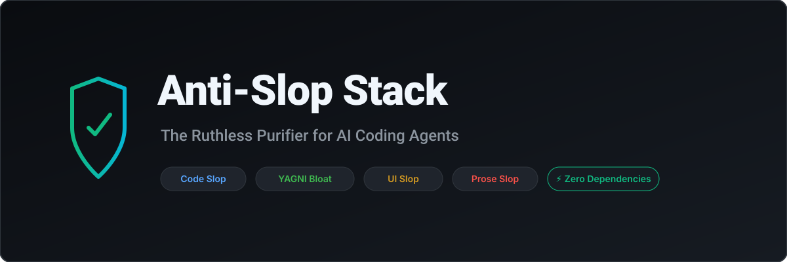

<p align="center">
  
</p>

# Anti-Slop Stack 🛡️

> **The ruthless multi-layer purifier for AI coding agents.**
> Strips away bloated boilerplate, hallucinated abstractions, narrative comments, generic AI template UIs, and robotic prose.

[](https://github.com/Dhani078/anti-slop-stack/actions/workflows/ci.yml)
[](https://github.com/Dhani078/anti-slop-stack)
[](https://opensource.org/licenses/MIT)
[]()
[]()
[]()

---

## 🎯 The Problem

Large Language Models (LLMs) and AI coding agents have an innate bias toward **AI Slop**:
- **Code Slop**: Trivial comments restating syntax, empty `catch (e) {}` blocks, unchecked `as any` band-aids.
- **YAGNI & Architecture Bloat**: Single-use interfaces, premature factories, speculative configuration, and wrapper functions that add zero semantic value.
- **UI Slop**: Cookie-cutter purple gradients, unstyled floating cards, hardcoded pixel widths breaking mobile viewports.
- **Prose Slop**: Buzzword salads (*"delve"*, *"leverage"*, *"testament"*, *"in today's rapidly evolving world"*).

`anti-slop-stack` operates as an automated Senior Staff Engineer and QA gatekeeper that detects, catalogs, and mechanically purges these patterns.

---

## ⚡ Quick Start

### 1. Run via npx (Zero Install)
```bash
npx anti-slop scan src/
```

### 2. Auto-Fix Mechanical Slop
Automatically strips trivial narrative comments, dead imports, and obvious residue:
```bash
npx anti-slop fix src/
```

### 3. Machine-Readable JSON Export
Output structured findings for CI/CD dashboards or Git pre-commit hooks:
```bash
npx anti-slop json src/
```

### 4. Custom Configuration (`.antisloprc.json`)
Configure thresholds and toggle rules per repository:
```json
{
  "rules": {
    "bloatSlop": {
      "maxLOC": 200
    }
  }
}
```

### 5. Install Git Pre-Commit Hook
Prevent degraded AI code from ever entering your Git history:
```bash
npx anti-slop init-hook
```
See [docs/PRE-COMMIT.md](docs/PRE-COMMIT.md) for Husky and Python `pre-commit` integrations.

### 6. GitHub Action (Reusable CI Workflow)
Add to your repository's `.github/workflows/quality.yml`:
```yaml
steps:
  - uses: actions/checkout@v4
  - uses: Dhani078/anti-slop-stack@main
    with:
      path: 'src'
      fail-on-violation: 'true'
```

### 7. CI Quality Gate
Fails the build with exit code `1` if high-severity violations exist:
```bash
npx anti-slop ci src/
```

---

## 🧩 4 Purification Layers

| Layer | Target | What it Eliminates |
|---|---|---|
| **1. Code Slop** | TypeScript, JavaScript, Python, PHP, Go, Rust | Narrative comments, swallowed exceptions (`catch {}`), `as any` / `@ts-ignore`, dead residue, leftover debug logs, destructive error wrapping, dangerous `eval()`. |
| **2. Architecture & Bloat** | Architecture & Modules | Single-implementation interfaces, speculative wrappers, files exceeding 200 LOC ceiling. |
| **3. UI & Visual Slop** | CSS, Tailwind, JSX, Vue | Generic AI purple glows, template card layouts, hardcoded width overflow risks, Tailwind template gradients (`from-purple-500 to-indigo-500`). |
| **4. Prose & Copy** | Markdown, HTML, Docs | AI clichés (`delve`, `leverage`, `seamless`), throat-clearing openings, passive voice, markdown bold overuse (`**term**`). |

---

## 🤖 Installation into AI Coding Agents

### For Hermes Agent
Clone into your Hermes skills directory:
```bash
cd ~/.hermes/skills/code-quality
git clone https://github.com/Dhani078/anti-slop-stack.git
```

### For Claude Code
Add to your project's `.claude/skills/`:
```bash
git clone https://github.com/Dhani078/anti-slop-stack.git .claude/skills/anti-slop-stack
```

### For OpenAI Codex / Cursor / Antigravity
Reference `SKILL.md` directly in your workspace rules or prompt instructions:
```markdown
Before finalizing code changes, execute anti-slop-stack to audit and eliminate unnecessary abstractions, narrative comments, and template bloat.
```

---

## 🧪 Testing

Run the included standalone verification suite (0 external dependencies):
```bash
npm test
```

Sample test output:
```text
Running test suite for anti-slop-stack...
✓ Code Slop scanner passed
✓ Code Slop fixer passed
✓ Architecture Bloat scanner passed
✓ UI Slop scanner passed
✓ Prose Slop scanner passed

All 5 test suites passed cleanly with 0 failures!
```

---

## 📄 Documentation

- [Architecture & Specification](SPEC.md) - Full technical design, rule taxonomy, and QA gates.
- [Visual Demonstration](docs/DEMO.md) - Before vs. after code comparison showing 48% LOC reduction.
- [Pre-Commit Hook Guide](docs/PRE-COMMIT.md) - Native Git, Husky, and Python pre-commit setup.
- [Contributing Guide](CONTRIBUTING.md) - Developer guidelines and zero-dependency principles.
- [Security Policy](SECURITY.md) - Vulnerability disclosure and security contacts.
- [Changelog](CHANGELOG.md) - Version release history and migration notes.

---

## 📄 License

MIT © [Dhani078](https://github.com/Dhani078)
